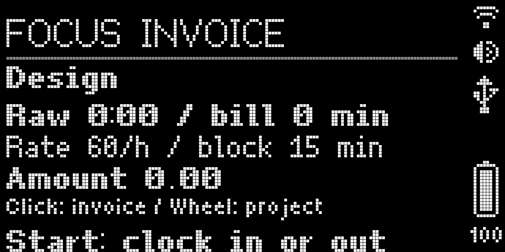

# Focus Invoice

Clock project sessions and round their combined duration once per project for billing.

Round the combined time for each project once. Several short interruptions on one job can fit within one billing block instead of each becoming a separate minimum charge.

A green play mark identifies the project currently on the clock. Two gray pause bars mean that project has recorded time and is stopped. An untouched project has no mark.

## Screen transitions

Switch between projects and browse the rounded invoice amount.


<details>

<summary>Watch the rear display</summary>



</details>

## Switch projects while working

1. Set the project names, hourly rate and billing block in device settings. Turn to the project you are starting and press **Start**.
2. Turn to another project when the work changes, then press **Start**. Browsing alone does not change the active timer.
3. Starting the new project settles the old one to its own total. In the first clip the selected name changes from Design to Research.


## Read the rounded amount

1. Click the wheel to switch the selected project from elapsed time to invoice amount. The rear shows raw duration, rounded billable minutes and rate.
2. Press **Start** on the active project to stop its timer. The amount remains available after the session ends.
3. Turn through projects to read their totals individually. Click again to get back to elapsed time.


## Example from the emulator

At 60 per hour with a 15-minute block, two four-minute sessions on one project total eight minutes. The rounded total is 15 minutes, or 15.00. A third ten-minute session takes raw time to 18 minutes and the billable total to 30.

## Run in the emulator

Open BUSY Bar Emulator. From this repository, run:

```sh
~/.busy-emulator/bin/busy-emulator dev --once
```

Press **Back** to exit.

The GIFs are excerpts from the emulator recording. Each LED occupies a 16 × 16 cell with a black border. The end frames pause for reading.

[Full recording](media/controls.mp4) · [Rear display](screenshots/back-1.png) · [Firmware test](EMULATOR-QA.md) · [MIT license](LICENSE)
